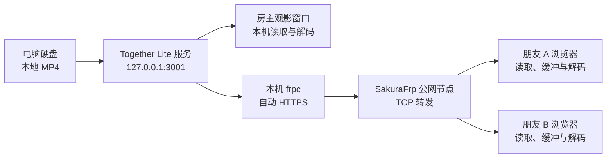
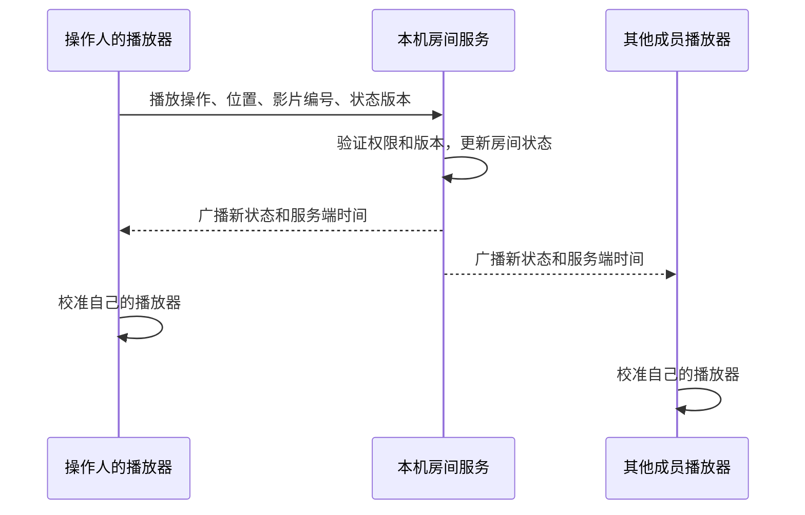

# Together Lite 功能与原理说明

版本：0.2.1 · 编写日期：2026 年 10 月 13 日

本文依据当前项目源码与已有验收记录编写，说明已经实现的本地影片同步观影和 SakuraFrp 接入。网页视频链接、屏幕共享只用于解释不同方案的区别，当前版本没有实现这些功能。

**先回答清晰度和稳定性的问题：本地影片能让你控制片源，当前程序不会再次压缩影片；但朋友通过网络观看时，是否流畅仍取决于家庭上行、SakuraFrp 节点和朋友的网络。相同视频文件通过本地共享或远程直链播放，不会因为“本地”或“链接”这个标签而天然产生画质差异。**

## 1. 这个项目做了什么

Together Lite 是部署在房主 Windows 电脑上的小型多人观影工具，房间人数为 2～4 人，包含房主。

房主打开桌面程序、选择电脑里的影片、创建观影室，然后将邀请链接或二维码发给朋友。朋友使用浏览器加入，点击一次“准备观看”，随后可以一起播放、暂停、拖动进度和聊天。

朋友无需先拿到整部电影，也无需安装桌面程序。影片仍在房主原来的磁盘位置，程序按播放需要发送数据。所有人各自解码播放，服务端协调大家应当看到的时间位置。

| 功能 | 当前实现 |
|---|---|
| 图形化选片 | 原生文件选择、拖入 MP4、添加影片文件夹 |
| 片库显示 | 缩略图、时长、文件大小、字幕提示 |
| 房间与邀请 | 创建房间、复制链接、二维码、更新邀请 |
| 影片播放 | 浏览器播放器、按需读取原文件、拖动定位 |
| 多人控制 | 播放、暂停、定位；可切换为仅房主控制 |
| 交流与成员状态 | 文字聊天、在线状态、准备与缓冲状态 |
| 字幕与个人设置 | WebVTT 字幕、音量、全屏；各自设置 |
| 网络恢复 | 断线暂停、尝试重连、恢复房间状态 |
| 外地访问 | SakuraFrp 内网穿透；也保留 IPv6 + Caddy 直连方式 |
| 持久化 | 保存软件设置和影片列表，房间与聊天保存在内存 |
| 网页视频链接、屏幕共享、语音 | 尚未实现 |
| 每人选择自己的同一份本地影片 | 尚未实现；当前仍由房主提供视频数据 |

界面接受 `.mp4` 文件，但 MP4 是封装格式，扩展名不能证明里面的编码一定兼容。当前建议准备 H.264 视频 + AAC 音频的 MP4；程序没有自动转码功能。

## 2. 软件由哪些部分组成

| 部分 | 使用的技术 | 承担的工作 |
|---|---|---|
| 房主桌面程序 | Electron | 提供窗口、文件选择、拖放、剪贴板与服务启停 |
| 桌面和观影界面 | Vue 3 + TypeScript | 展示片库、设置、房间、播放器和聊天 |
| 本机服务 | Node.js + Fastify | 处理房间 API、身份验证、网页与影片请求 |
| 播放同步 | WebSocket，使用 `ws` | 传递播放操作、房间状态、聊天和心跳 |
| 视频解码 | 浏览器的 HTML5 `<video>` | 将影片字节解码为画面和声音 |
| 公网入口 | SakuraFrp 启动器与 frpc | 将公网访问转发到本机服务，提供当前 HTTPS 入口 |
| 可选直连入口 | Caddy | 在 IPv6 直连模式下处理 HTTPS |

桌面安装包和免安装程序已经带有运行环境，普通使用者不需要自行安装 Node.js。桌面管理窗口通过受限制的 IPC 接口调用本机功能，朋友的观影页面没有选择磁盘文件或管理电脑的权限。

需要区分两种网络模式：

- **当前的 SakuraFrp 模式**：Together Lite 监听 `127.0.0.1:3001`，本机 frpc 连接它。HTTPS 由 frpc 的自动 HTTPS 功能处理，Together Lite 不额外启动 Caddy。
- **保留的 IPv6 直连模式**：配置域名后，由本机 Caddy 接收 HTTPS 并转发给本机应用；需要正确的 DNS 与入站访问条件。没有配置公网入口时，也可以运行局域网模式。

Electron 本身包含多个进程，SakuraFrp 启动器也有自己的服务进程。因此“一套本地应用”不等于任务管理器里只有一个进程。

## 3. 影片怎样从电脑到朋友的手机

当前使用 SakuraFrp 时，下面的箭头表示**视频数据返回给观众的方向**；朋友的读取请求沿相反路线到达电脑。



房主在桌面程序内打开的观影窗口使用本机服务地址，正常情况下不需要绕到 SakuraFrp 公网节点。外地朋友通过配置的 HTTPS 地址访问。

本次观影隧道名为 `film`，类型为 TCP，本地地址为 `127.0.0.1:3001`，公网端口为 `48732`。本地端口和公网端口不需要相同：前者是电脑上的服务入口，后者是穿透节点给朋友使用的入口。

网页、房间 API、视频读取和播放同步都复用这条入口。朋友使用 HTTPS 时，播放同步连接使用 WSS，也就是加密的 WebSocket。

**TCP 是隧道类型，HTTPS 是应用的访问协议。** 开启自动 HTTPS 并绑定子域名证书后，frpc 接收 HTTPS，解开 TLS 后连接本机 HTTP 服务。SakuraFrp 在这条链路中承担公网接入和流量转发，并没有代替浏览器播放电影，也没有替项目重新编码画面。[SakuraFrp 转发原理](https://doc.natfrp.com/basics.html)、[自动 HTTPS 原理](https://doc.natfrp.com/frpc/auto-https.html)

项目没有先将整部影片上传到云端片库保存，而是在朋友读取时转发所需数据。使用穿透以后，视频确实会经过第三方节点；“影片保存在本机”和“影片不经过第三方节点”是两件不同的事。

## 4. 为什么不用等整部影片下载完

浏览器可以发送 HTTP Range 请求，告诉服务器只读取文件的一段字节。服务端验证房间身份后，打开对应影片，返回指定的文件区间。[HTTP Range 说明](https://developer.mozilla.org/en-US/docs/Web/HTTP/Guides/Range_requests)

例如，下面是一个示意请求：

```http
GET /api/rooms/房间ID/media/影片ID
Range: bytes=1048576-2097151
```

假设影片总大小为 2,000,000,000 字节，返回内容可以是：

```http
HTTP/1.1 206 Partial Content
Accept-Ranges: bytes
Content-Type: video/mp4
Content-Length: 1048576
Content-Range: bytes 1048576-2097151/2000000000
```

实际实现支持普通完整请求、单段区间、从某字节到末尾以及末尾若干字节，也处理超出文件范围的请求和只读取响应头的 HEAD 请求。

用户拖到第 30 分钟时，浏览器依据 MP4 的媒体索引寻找所需的文件位置，再请求附近数据。服务器处理的是字节区间，不是自己把“30 分钟”换算成某个固定字节位置。

浏览器可以边读取边播放，也可能预读一部分数据。因此“不必先下载整部影片”不代表完全没有下载、缓存或预读。MP4 的索引布局也会影响首次加载；将索引放到文件前部的 faststart 文件通常更适合这种使用方式。参见 [FFmpeg 对 faststart 的说明](https://ffmpeg.org/ffmpeg-formats.html#mov_002c-mp4_002c-ismv)。

**当前传输接口直接读取原 MP4 的文件字节，不解码、不缩放，也不重新编码视频。** 浏览器收到数据后才负责解码。片库缩略图虽然会生成一张较小的 JPEG，但它只用于片库展示，不会降低正式播放的影片画质。

## 5. 多人同步怎样实现

影片数据和播放状态采用不同的传输方式：

| 内容 | 传输方式 | 数据特点 |
|---|---|---|
| 影片画面与声音 | HTTP/HTTPS 文件读取 | 占用主要带宽，浏览器各自读取 |
| 播放、暂停、定位 | WebSocket/WSS | 少量状态消息 |
| 聊天、成员状态、心跳 | WebSocket/WSS | 少量文本与状态消息 |

因此 WebSocket 没有传输电影画面。即使同步消息已经送达，网络较慢的朋友仍可能因为视频数据不足而缓冲。

服务端为每个房间保存一份权威播放状态，核心字段如下：

```ts
type RoomState = {
  videoId: string;  // 当前影片
  playing: boolean;
  position: number; // 更新状态时的影片位置，单位为秒
  updatedAt: number;
  version: number;  // 状态版本
};
```

有人点击播放时，客户端发送操作和它看到的状态版本。服务端检查成员权限、影片编号和版本，更新房间状态，再广播给房间成员。旧版本的操作会被拒绝并返回当前状态，避免迟到的消息覆盖较新的操作。



播放中的目标位置可以根据经过的时间推算：

```text
目标位置 = 状态记录的位置 + 距离上次状态更新经过的时间
```

例如服务端在某时刻记录“从 600 秒开始播放”，5 秒后目标位置约为 605 秒；暂停时目标位置保持不变。计算前，客户端通过 ping/pong 估计与服务端的时钟偏差，不直接假设不同设备的系统时间完全一致。

当前播放器每 500 毫秒检查一次偏差。播放中，偏差不大时保持正常速度；偏差超过 0.18 秒但不超过 1.2 秒时，尝试用 0.97 或 1.03 倍速轻微追赶；偏差更大时重新定位。暂停状态采用更小的位置偏差阈值。实际校准还受缓冲、正在拖动、浏览器定位状态和定位间隔影响。

这是一个持续校准的同步方案，不是逐帧锁定。它可以让大家基本处于同一段剧情，但不能承诺所有网络下始终保持零毫秒误差。

有人缓冲时，其他人会继续播放；当前版本不会自动暂停全房间等待最慢的成员。若想一起等人，应主动暂停。网络恢复后，慢的一端会重新跟上房间位置。

## 6. 为什么要点击“准备观看”，断线后会怎样

手机浏览器通常限制未经用户操作的有声自动播放。因此每个人加入后要先点击“准备观看”，由这次点击启动播放器，再根据房间状态决定继续播放还是暂停。

同步连接断开时，播放器会暂停，客户端按逐步增加的等待时间尝试重连。重新连接后，服务端发送房间完整状态；页面从后台回到前台时，也会请求状态更新。浏览器若再次要求播放手势，界面会提示重新点击准备。

聊天与成员状态存在本机服务内存中，退出或重启服务后不会保留。影片路径、字幕关联、昵称、端口和外网地址等设置会保存为 JSON。通过本项目的 `SakuraFrp观影.cmd` 启动时，设置保存在 `local-data/preferences.json`；普通安装版使用 Electron 的用户数据目录，两种入口不一定共用同一个片库。

## 7. 邀请链接与文件权限

创建房间时会生成随机房间编号和邀请凭据。朋友用凭据加入后取得房间会话，随后的视频接口和 WebSocket 都检查会话和成员资格。

当前实现的主要边界是：

- 朋友只能读取自己已加入房间的当前影片和字幕，不能直接获取房主整个片库。
- 客户端请求使用影片编号，不允许任意指定电脑磁盘路径。
- 文件读取会检查路径、文件类型、符号链接和文件是否改变。
- 更新邀请后，旧邀请不能再供新成员加入；已经加入的人仍可观看。
- 结束房间、移出成员或停止服务会撤销对应访问能力。
- 桌面管理窗口有选片权限；普通观影窗口没有桌面管理桥。

这些措施服务于小房间的访问控制，不意味着系统可以阻止已获准观看的人复制其收到的视频数据。它不是 DRM 系统。

## 8. 本地影片会比“链接播放”更清晰、更稳定吗

首先区分“你自己在电脑上看”和“把本地影片分享给外地朋友”。前者主要依赖磁盘、电脑和本机播放器；后者仍然需要网络传输。

### 8.1 清晰度取决于片源，当前程序不会额外压缩

画质受到原始片源、编码方式、分辨率、码率等因素影响。一个被严重压缩的 1080p 文件不一定比高质量的较低分辨率视频更好；不同编码的码率也不能机械比较。[视频编码与画质因素](https://developer.mozilla.org/en-US/docs/Web/Media/Guides/Formats/Video_codecs)

当前程序直接提供原 MP4，所以你选择什么版本，就发送那个版本。网络不好时，它没有另一份低清晰度版本可以自动切换，通常表现为等待缓冲，而不是主动把影片降成低清晰度。

如果未来加入链接模式，链接实际指向同一个 MP4，且直接提供相同文件字节，那么本地共享和直链播放在片源画质上可以相同。播放器缩放、设备屏幕、色彩处理或解码能力仍可能造成显示差别，不能承诺不同设备看起来完全一致。

如果比较的是视频网站的在线版本，则要看平台提供的具体片源。高质量本地文件可能更清晰，低质量本地文件也可能更差。“来自本地”本身不创造画质优势。

如果比较的是屏幕直播，直播通常要把已经解码显示的画面再次采集、编码，可能引入压缩损失和帧率变化；当前原文件分发省去了这次画面编码过程。屏幕共享尚未实现，这里只是说明技术差异。

### 8.2 本地文件让片源更可控，但外地传输不一定更稳定

本地文件的可控性体现在：影片不会因为远程地址过期而突然找不到；所有人观看的是同一个文件版本；不需要处理第三方网页的广告、登录状态或播放器变化。你仍需要保持文件存在、软件运行，并准备兼容格式。

外地朋友的传输路径包含家庭上行、frpc、SakuraFrp 节点及朋友网络。高码率文件或者同时加入更多观众，都可能超过其中某段路径的能力。房主自己在本机播放流畅，不能单独证明外地朋友也会流畅。

如果未来的链接模式让每位观众直接从一个容量充足的源站/CDN 读取影片，则视频流量不必经过你的家庭上行，它可能比家庭电脑加穿透更流畅。部分流媒体方案还能随网络条件调整播放码率，以降低卡顿，但具体网站是否这样做需要实际确认。[HLS 自适应播放说明](https://developer.apple.com/streaming/)

如果未来把远程链接先由你的电脑读取，再代理转发给大家，就仍然会占用家庭上行和穿透带宽，不能把它视为“每人直接从 CDN 下载”。当前版本没有实现这两种链接模式。

### 8.3 同步稳定性还要看是否观看相同内容

当前本地模式由同一房间提供同一影片编号和文件，播放位置的含义比较一致。若未来接入网页视频，不同广告、片头、影片版本或播放器接口可能让“第 600 秒”不再对应同一段内容，需要站点适配。

即使大家使用同一原文件，缓冲、设备性能、时钟估计和网络延迟仍会影响同步。画质清晰、视频流畅、播放位置一致，是三个相关但不能相互替代的指标。

| 比较场景 | 清晰度判断 | 稳定性判断 |
|---|---|---|
| 房主本人通过本机入口看本地文件 | 保留所选片源质量 | 不受外部视频源和穿透传输影响，仍受本机性能影响 |
| 本地影片共享给外地朋友 | 不做二次视频编码 | 受家庭上行、穿透节点、朋友网络和解码能力限制 |
| 相同 MP4 的可用远程直链，未来模式 | 相同片源可以相同画质 | 主要取决于源站和各观众网络，不一定比本地共享差 |
| 视频网站播放页，未来模式 | 取决于平台实际提供的版本 | CDN 可能更强，但需处理播放器、账号及内容版本差异 |
| 屏幕直播，未来模式 | 可能受到再次编码影响 | 另有采集、编码和直播传输延迟；尚未验收 |

**对于你现在的用途，本地文件方案的优势是“片源和功能由自己掌握、直接发送原片”，不是“任何情况下都比网站更清晰、更不卡”。目前没有相同片源、相同网络条件下的本地与链接 A/B 测试，不应把这种优势写成绝对性能结论。**

## 9. 怎样估算所需带宽

对当前“每位外地观众独立读取视频”的模式，可用下面的估计：

```text
房主视频上传需求 ≈ 影片平均总码率 × 外地观众数量
```

如果影片平均总码率为 4 Mbps，你自己在本机看，再邀请 3 位外地朋友，那么影片上传量约为：

```text
4 Mbps × 3 = 12 Mbps
```

这里只计算影片的平均持续需求，未包含协议开销、重传、重复读取和突发预读，也没有保证瞬时码率恒为 4 Mbps。实际链路需要余量，平均测速刚好达到这个数字仍可能卡顿。

按完整播放 2 小时估计，一位观众读取的影片数据约为：

```text
4,000,000 bit/s × 7,200 s ÷ 8 ≈ 3.6 GB
3 位观众合计约 10.8 GB
```

这里的 GB 按十进制计算，是影片有效字节量的估算，不是 SakuraFrp 套餐扣量口径。跳转、预读和重新加载也会改变实际传输量。

例如，你家的可用上行只有 8 Mbps，就无法长期支撑上述约 12 Mbps 的影片需求。即使文件很清晰，朋友也可能逐渐耗尽缓冲而卡顿。反过来，有效吞吐足够且源文件兼容时，直接发送文件字节不需要为了传输主动牺牲画质。

## 10. 主要源码怎样对应这些原理

| 源码位置 | 对应职责 |
|---|---|
| `desktop/main.mjs` | 桌面窗口、原生文件选择、IPC 权限、打开房主观影窗口 |
| `desktop/preload.cjs` | 暴露有限的本机操作桥，不向观影网页开放 Node.js |
| `desktop/controller.mjs` | 保存设置、管理片库、启动服务、选择穿透或直连、检查入口 |
| `desktop/renderer/Desktop.vue` | 桌面片库、房间、连接与分享、软件设置 |
| `desktop/renderer/MovieCard.vue` | 读取元数据，生成片库缩略图 |
| `server/app.ts` | 房间 API、会话与权限、影片/字幕接口、网页服务 |
| `server/video.ts` | 媒体扫描、允许目录检查、原文件读取、Range 解析 |
| `server/rooms.ts` | 内存中的房间、成员、状态、聊天及广播 |
| `server/sync.ts` | WebSocket 验证、操作版本检查、聊天和心跳 |
| `client/src/Player.vue` | 浏览器播放器、准备观看、音量字幕、位置校准 |
| `client/src/SyncClient.ts` | WSS 连接、时钟估计、心跳、重连、目标位置推算 |
| `client/src/Room.vue` | 加入房间、成员聊天、换片、控制权限与页面恢复 |
| `shared/protocol.ts` | 客户端和服务端共同使用的消息与状态类型 |

## 11. 已验证到什么程度

2026 年 10 月 13 日的已有记录包含：19 项自动测试；实际打包桌面基础流程 16 项；实际免安装 EXE 流程 5 项；真实 SakuraFrp HTTPS 浏览器流程 10 项；桌面穿透操作流程 7 项。

真实穿透验收包括证书验证、两名独立浏览器参与者的原片解码与同步、暂停、定位、聊天、Range 返回字节与原文件对应区间一致、匿名视频访问被拒绝，以及重连和结束房间。

现有自动化的手机画面主要使用独立 Edge 的手机尺寸窗口；用户已反馈访问可用。这些结果不能替代真实手机长时间观影、多运营商与不同高码率影片的稳定性测试，也不能证明所有浏览器、所有影片编码均兼容。

自动测试位于 `tests/`，可以通过 `npm test` 复现。打包桌面与真实穿透检查属于发布前的本地验收；包含实际地址或邀请信息的运行记录和截图不纳入公开仓库。

日常操作参见 [使用指南](用户指南.md)。

本文记录当前实现和技术原理，不将尚未开发的链接同步、屏幕共享或自动转码计入现有功能。
